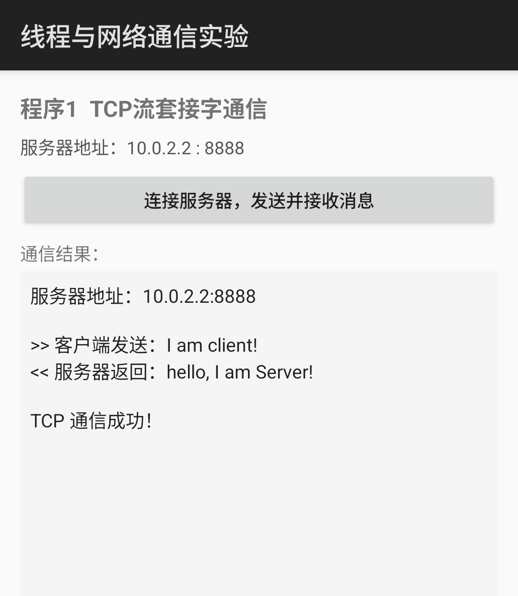
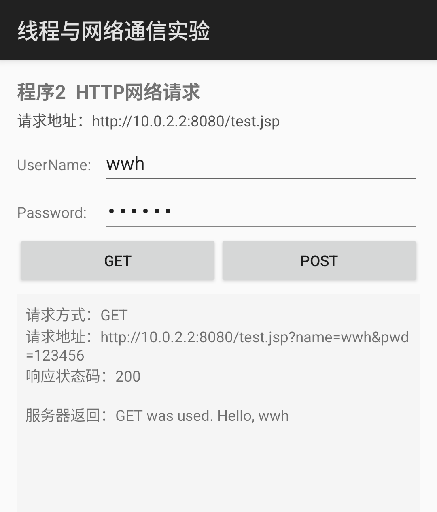

# 移动终端软件开发 · 实验三：线程与网络通信

Android 端四个程序的完整实现（TCP 流套接字通信、HTTP 网络请求、WebView 加载网页、
LocationManager 定位）、配套 Java 服务器、运行截图和实验报告（答题卡）。

- 学生：胡俊峰
- 学号：202402323
- 班级：计算机249
- 实验指导书：实验三 线程与网络通信
- 报告日期：2026.11.06

## 实验内容

| 程序 | 知识点 | 实现说明 |
| --- | --- | --- |
| 程序 1 | TCP 流套接字通信 | Java `TcpServer` 在 8888 端口监听；`TcpClientActivity` 在子线程中用 `Socket` 连接 10.0.2.2:8888，发送 `I am client!` 并接收 `hello, I am Server!` |
| 程序 2 | HTTP 网络请求 | `HttpActivity` 用 `HttpURLConnection` 向 `http://10.0.2.2:8080/test.jsp` 发送 GET/POST 请求，服务端校验 name=wwh、pwd=123456 |
| 程序 3 | WebView 加载网页 | `WebViewActivity` 初始化 `WebSettings`、设置 `WebViewClient` 回调，输入网址后 `loadUrl()` 加载（实测腾讯网、本地页面） |
| 程序 4 | LocationManager 定位 | `LocationActivity` 动态申请定位权限，注册 `LocationListener`，显示 GPS 经纬度、海拔、精度与时间 |

## 运行环境

- Android Studio（Gradle 8.11.1 + AGP 8.7.3）
- JDK 21（`gradle.properties` 中通过 `org.gradle.java.home` 指定，可按本机环境修改）
- compileSdk 35 / minSdk 24 / targetSdk 34
- 模拟器：Pixel 7（API 35，Android 15），1080×2400
- 服务端：JDK 21 运行 `server/` 下的两个 Java 程序

## 目录结构

```
android/Lab3ThreadsNetwork/         Android 工程源码（Java）
  app/src/main/java/com/example/threadsnetwork/
    MainActivity.java               四个程序的入口菜单
    TcpClientActivity.java          程序 1：TCP 客户端
    HttpActivity.java               程序 2：GET/POST 请求
    WebViewActivity.java            程序 3：WebView 加载网页
    LocationActivity.java           程序 4：LocationManager 定位
  app/src/main/res/layout/          各程序的布局文件
server/
  TcpServer.java                    TCP 服务器（端口 8888）
  HttpTestServer.java               HTTP 服务器（端口 8080，模拟 test.jsp）
  启动服务器.cmd                     一键编译并启动两个服务器
screenshots/                        运行截图（crops/ 为报告用裁剪图）
report/
  实验三、线程与网络通信-202402323-胡俊峰.docx   答题卡（可编辑）
  实验三、线程与网络通信-202402323-胡俊峰.pdf    提交用实验报告
docs/answers.md                     思考题与实验小结文字
docs/答题卡.docx                    原始答题卡模板
```

## 构建与运行

```bash
# 1. 启动服务器（在 server 目录下，任选一种）
启动服务器.cmd
# 或
javac -encoding UTF-8 TcpServer.java HttpTestServer.java
java TcpServer        # 窗口 1：TCP 8888
java HttpTestServer   # 窗口 2：HTTP 8080

# 2. 在 Android Studio 中打开 android/Lab3ThreadsNetwork 并运行 app
#    或命令行构建：
cd android/Lab3ThreadsNetwork
./gradlew assembleDebug

# 3. 安装后可从菜单进入四个程序：
adb shell am start -n com.example.threadsnetwork/.MainActivity
# 也可直接启动单个程序：
adb shell am start -n com.example.threadsnetwork/.TcpClientActivity
adb shell am start -n com.example.threadsnetwork/.HttpActivity
adb shell am start -n com.example.threadsnetwork/.WebViewActivity
adb shell am start -n com.example.threadsnetwork/.LocationActivity
```

模拟器内的 `10.0.2.2` 指向宿主机；真机测试时把 `TcpClientActivity` 中的
`SERVER_IP`、`HttpActivity` 中的 `HTTP_URL` 改成主机的局域网 IP（如 `10.28.137.252`）。

### 定位调试

```bash
# 授予定位权限
adb shell pm grant com.example.threadsnetwork android.permission.ACCESS_FINE_LOCATION
# 设置模拟器经纬度（北京 116.397, 39.909），程序即可收到 onLocationChanged 回调
adb emu geo fix 116.397 39.909
```

## 运行截图

| TCP 通信（客户端） | HTTP GET | WebView |
| --- | --- | --- |
|  |  |  |

更多截图见 [`screenshots/`](screenshots/)（原始全屏截图）与 [`screenshots/crops/`](screenshots/crops/)（报告中使用的裁剪图）。

## 实验报告

- PDF：[report/实验三、线程与网络通信-202402323-胡俊峰.pdf](report/实验三、线程与网络通信-202402323-胡俊峰.pdf)
- 可编辑源文件：[report/实验三、线程与网络通信-202402323-胡俊峰.docx](report/实验三、线程与网络通信-202402323-胡俊峰.docx)

报告按答题卡原有版式填写，包含四个程序的关键代码、运行截图与标注、思考题答案及实验小结。
